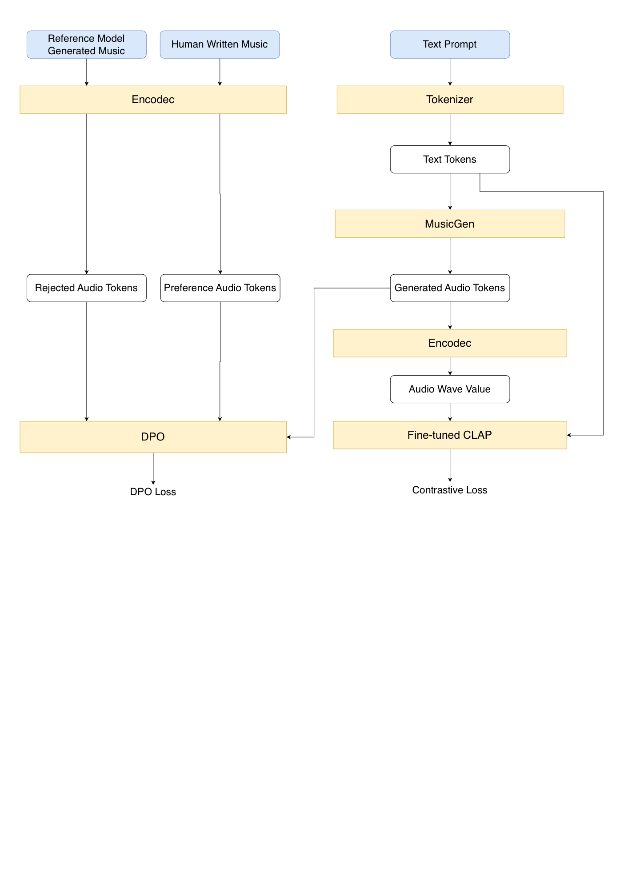

# MusicDPO

MuGenDPO is a preference-optimization pipeline for text-to-music
generation. It adapts [`facebook/musicgen-small`](https://huggingface.co/facebook/musicgen-small)
with LoRA and Direct Preference Optimization (DPO), using pairs of preferred
and rejected audio for the same text prompt.

The project follows a two-stage training procedure:

1. Fine-tune CLAP to provide a task-specific text-audio similarity signal.
2. Fine-tune MusicGen with DPO, while adding a contrastive CLAP loss to improve
   alignment between the prompt and generated music.

The detailed project presentation is available in
[`figure/MusicDPO.pdf`](./figure/MusicDPO.pdf).

## Overview

The main data flow is shown below:



## Project structure

```text
MusicDPO/
├── code/
│   ├── trainer.py              # MusicGen + DPO + CLAP training
│   ├── trainer_wo_CLAP.py      # DPO-only ablation
│   ├── inference.py            # Base/fine-tuned audio generation
│   └── train.sh                # Example multi-run training script
├── figure/
│   ├── model.pdf               # Workflow diagram
│   └── MusicDPO.pdf            # Detailed project presentation
├── music_label_genre.csv       # Prompt metadata
├── train_segments_25sec/       # Preferred audio
├── output_wav/                 # Rejected audio
├── requirements.txt
└── clap_model_epoch_29.pth     # Fine-tuned CLAP checkpoint
```

Run all commands from the `MusicDPO/` project root. The scripts use paths
relative to this directory.

## Setup

Install the dependencies:

```bash
pip install -r requirements.txt
```

Use a GPU environment when possible. The trainer uses 8-bit model loading and
the paged optimizer provided by `bitsandbytes`. Install a PyTorch and
TorchAudio build compatible with the local CUDA and operating-system setup if
the versions selected by `requirements.txt` are unsuitable.

The following pretrained models are downloaded automatically from Hugging Face
on first use:

- `facebook/musicgen-small`
- `facebook/encodec_32khz`
- `laion/clap-htsat-unfused`

The local CLAP checkpoint is not downloaded automatically. It must be supplied
as `clap_model_epoch_29.pth`.

## Data preparation

The metadata CSV must contain at least:

```text
id,prompt
```

For each CSV row, `code/trainer.py` searches for:

- preferred audio: `train_segments_25sec/{id:04d}_*.wav`
- rejected audio: `output_wav/{prompt}_*.wav`

Audio is resampled to 32 kHz. The current implementation keeps only pairs
whose waveform lengths are 800,000 samples for preferred audio and 817,280
samples for rejected audio. The number of retained pairs is printed when the
dataset is prepared.

## Training

### Stage 1: Fine-tune CLAP

The first stage produces the task-specific checkpoint:

```text
clap_model_epoch_29.pth
```

This checkpoint is loaded by `code/trainer.py` and used as a frozen evaluator
of text-audio compatibility during MusicGen training. The current repository
contains the checkpoint interface and loading code, but does not contain the
CLAP fine-tuning script. The original CLAP dataset, preprocessing, optimizer,
training schedule, and checkpoint-saving command therefore need to be
reconstructed separately.

### Stage 2: Fine-tune MusicGen with DPO

Start the default MusicGen training run:

```bash
python code/trainer.py
```

The default settings are:

```text
base model:              facebook/musicgen-small
epochs:                  1
batch size:              4
gradient accumulation:   8
learning rate:           2e-4
DPO beta:                0.1
LoRA rank:               8
LoRA alpha:              8
LoRA dropout:            0.05
CLAP checkpoint:         ./clap_model_epoch_29.pth
```

The training loop performs the following operations:

1. Loads prompt, preferred-audio, and rejected-audio examples.
2. Converts the audio examples into EnCodec tokens.
3. Tokenizes the text prompts with the MusicGen processor.
4. Adds LoRA adapters to MusicGen `q_proj` and `v_proj` modules.
5. Computes the policy and reference log probabilities for DPO.
6. Generates/decodes audio and computes the CLAP text-audio contrastive loss.
7. Optimizes the MusicGen LoRA parameters and saves an adapter checkpoint.

Conceptually, the DPO term encourages the policy to assign higher relative
likelihood to preferred audio than rejected audio:

```math
\mathcal{L}_{\mathrm{DPO}}
= -\log \sigma\left(
\beta \left[
\left(\log \pi_\theta(y^+ \mid x)-\log \pi_\theta(y^- \mid x)\right)
- \left(\log \pi_{\mathrm{ref}}(y^+ \mid x)
- \log \pi_{\mathrm{ref}}(y^- \mid x)\right)
\right]\right)
```

where \(x\) is the text prompt, \(y^+\) is the preferred audio, \(y^-\) is
the rejected audio, \(\pi_\theta\) is the trainable MusicGen policy, and
\(\pi_{\mathrm{ref}}\) is the frozen reference model.

The CLAP term compares generated-audio embeddings with text embeddings using a
temperature-scaled contrastive objective. For a batch of \(N\) examples, the
implementation uses:

```math
s_{ij} = \frac{
\text{cos}\left(\mathbf{a}_i,\mathbf{t}_j\right)
}{\tau},
\qquad
\mathcal{L}_{\mathrm{CLAP}}
= -\frac{1}{N}\sum_{i=1}^{N}
\log\frac{\exp(s_{ii})}{\sum_{j=1}^{N}\exp(s_{ij})},
```

where \(\mathbf{a}_i\) is a generated-audio embedding,
\(\mathbf{t}_j\) is a text embedding, and \(\tau\) is the temperature
(0.07 in the implementation). The total training objective is:

```math
\mathcal{L}_{\mathrm{total}}
= \mathcal{L}_{\mathrm{DPO}}+\mathcal{L}_{\mathrm{CLAP}}.
```

Checkpoints are saved after each epoch:

```text
checkpoints/
└── musicgen-dpo_epoch_1/
    ├── adapter_config.json
    └── adapter_model.safetensors
```

To override the default configuration:

```bash
python code/trainer.py \
  --epochs 10 \
  --batch_size 4 \
  --accumulation_steps 8 \
  --lr 2e-4 \
  --save_model_path ./checkpoints/musicgen-dpo \
  --clap_ckpt ./clap_model_epoch_29.pth
```

The first run may create `tokenized_outcome/` for cached text and audio-token
tensors. Optional Weights & Biases logging is enabled with:

```bash
python code/trainer.py \
  --use_wandb \
  --wandb_project musicgen-dpo \
  --wandb_run_name musicgen-dpo-small
```

The provided [`code/train.sh`](./code/train.sh) shows an example of running
15-epoch experiments with two learning rates and separate checkpoint
directories:

```bash
sh code/train.sh
```

### DPO-only ablation

[`code/trainer_wo_CLAP.py`](./code/trainer_wo_CLAP.py) contains the
corresponding DPO-only variant. It omits CLAP model loading and the additional
CLAP loss, so it can be used to compare preference optimization with and
without the semantic alignment objective.

## Inference

After training, generate music from the fixed prompt in
`code/inference.py`:

```bash
python code/inference.py \
  --peft_model ./checkpoints/musicgen-dpo_epoch_1 \
  --base_model facebook/musicgen-small \
  --output_dir ./output
```

The current script uses:

```text
Solo Violin in D major with Baroque style
```

It writes two WAV files:

```text
output/
├── musicgen_out.wav
└── musicgen_ft_out.wav
```

These files are intended for an audio comparison between the base MusicGen
model and the LoRA-adapted model. The output sample rate is read from the
MusicGen configuration, and generation is stochastic because
`do_sample=True`.

## Sample outcomes

The repository includes example generations in
[`sample_outcome/`](https://drive.google.com/drive/folders/1eCj3fIKtIuspHy8SR4x7K3S768wHbaMX?usp=sharing). Click a WAV file to open or download it;
the GitHub file viewer provides an audio player for supported audio files.

### Sample 1

| Experiment | 🔊 Listen |
| --- | --- |
| Fine-tuned MusicGen with CLAP | [▶️ Listen](https://drive.google.com/file/d/1gBybd6IfGolgjdozfpau9H-n0wM6LSjR/view?usp=sharing) |
| MusicGen without CLAP loss | [▶️ Listen](https://drive.google.com/file/d/1F-OILvQn1MoO5aqB7zNLzNcm0gzk4mcK/view?usp=sharing) |
| No fine-tuning | [▶️ Listen](https://drive.google.com/file/d/1PMowQFxEl65751wuYtDM3205iMZ7oXlO/view?usp=sharing) |
| Pretrained CLAP | [▶️ Listen](https://drive.google.com/file/d/13AOCNp1RSX1pgAuTQ9gEvmdAbjBfPfIg/view?usp=sharing) |

### Sample 2

| Experiment | 🔊 Listen |
| --- | --- |
| Fine-tuned MusicGen with CLAP | [▶️ Listen](https://drive.google.com/file/d/1rM4VmpcvNnm6aZq-JwgaX0-vDIlZGV7n/view?usp=sharing) |
| MusicGen without CLAP loss | [▶️ Listen](https://drive.google.com/file/d/1w5KtQcTmh1_SO3RkeKuLZH7-0YOrOcv8/view?usp=sharing) |
| No fine-tuning | [▶️ Listen](https://drive.google.com/file/d/1txsi-vwEfIq1HW5HYpLGxnGr8ig-xN6Z/view?usp=sharing) |
| Pretrained CLAP | [▶️ Listen](https://drive.google.com/file/d/1XKTqfQKs8FUA6BvV_belbuR-lHpWmcDU/view?usp=sharing) |

## Reproducing the pipeline

From the `MusicDPO/` directory:

1. Place the preferred/rejected audio data and `music_label_genre.csv` in the
   locations described above.
2. Place the fine-tuned CLAP checkpoint at
   `./clap_model_epoch_29.pth`.
3. Run MusicGen DPO training:

   ```bash
   python code/trainer.py \
     --epochs 1 \
     --batch_size 4 \
     --accumulation_steps 8 \
     --save_model_path ./checkpoints/musicgen-dpo
   ```

4. Generate the comparison samples:

   ```bash
   python code/inference.py \
     --peft_model ./checkpoints/musicgen-dpo_epoch_1 \
     --base_model facebook/musicgen-small \
     --output_dir ./output
   ```

Exact audio outputs can vary because inference is sampled. Results also depend
on the versions of PyTorch, Transformers, PEFT, CUDA, and the downloaded model
weights.
